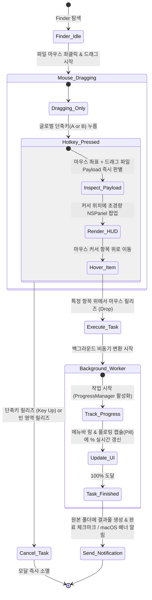
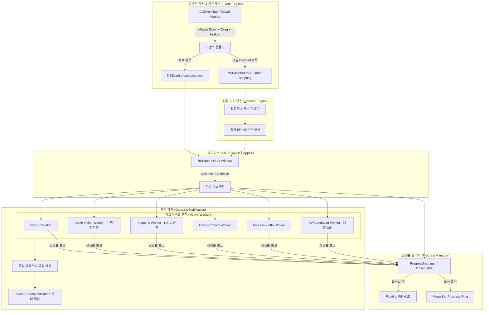

# macOS 백그라운드 파일 변환/가공 유틸리티 개발 계획서

> **문서 상태**: 기능 확정 및 개발 준비 단계 (Confirmed v1.1)  
> **대상 플랫폼**: macOS 13.0+ (Ventura, Sonoma, Sequoia 호환 / Apple Silicon & Intel Universal Binary)  
> **핵심 기술**: Swift, SwiftUI, AppKit (`NSPanel`), Apple Vision, PDFKit, AVFoundation, Quartz (`CGEventTap`)

---

## 1. 프로젝트 개요 및 핵심 UX 플로우

본 프로젝트는 Finder에서 파일을 드래그하는 도중 글로벌 단축키를 입력하면, 마우스 포인터 위치에 즉각 컨텍스트 모달이 호출되고 마우스 버튼을 놓는 위치에 따라 작업을 백그라운드에서 즉시 실행하는 **초경량 제스처 기반 파일 변환/가공 유틸리티**입니다.

### 1.1 인터랙션 플로우 (Interaction Flow)



### 1.2 사용자 제스처 상태 정의

| 제스처 단계 | 시스템 동작 | 비고 |
| :--- | :--- | :--- |
| **1. Drag & Hold** | Finder 파일 선택 후 마우스 좌클릭을 유지한 채 드래그 | macOS 네이티브 드래그 세션 생성 |
| **2. Hotkey Down** | 단축키 A(형식 변환) 또는 B(가공) 입력 | 커서 좌표에 `NSPanel` 즉시 표시 (애니메이션 딜레이 없음) |
| **3. Release to Execute** | 단축키를 유지한 채 원하는 메뉴 위에서 마우스 좌클릭 해제 | 해당 백그라운드 작업 즉시 실행 + 로딩률 인디케이터 활성화 |
| **4. Release to Cancel** | 메뉴 항목 외 영역에서 마우스 해제 또는 단축키(Key Up) 해제 | 작업 없이 모달 즉각 소멸 |

---

## 2. 확정된 상황 인지형(Context-Aware) 모달 메뉴 명세

사용자에게 "A to B" 같은 장황한 문구 대신, **최종 결과물 또는 실행 액션**만 직관적으로 표시합니다.

### 2.1 [단축키 A] 형식 변환 모달 (Format Conversion)

선택된 원본 파일의 종류와 개수에 따라 다음 항목이 동적으로 노출됩니다:

| 원본 파일 맥락 | 모달 노출 명칭 (Target) | 실행 및 결과물 |
| :--- | :--- | :--- |
| **PDF 단일 선택** | **`PNG`** | 각 페이지별 고해상도(300 DPI) 이미지 분할 추출 (`파일명_page_1.png`...) |
| **PNG 다중 선택** | **`PDF`** | 파일명/생성일 순 정렬 후 단일 PDF로 병합 (`파일명_merged.pdf`) |
| **HEIC 단일/다중 선택** *(확정)* | **`JPG`** / **`PNG`** | 아이폰 에어드롭 사진을 범용 고화질 포맷으로 초고속 일괄 변환 |
| **Office 문서 (PPTX, DOCX)** | **`PDF`** | macOS 내장 엔진 / Keynote·Pages 무음 AppleScript를 통한 PDF 변환 |
| **PDF 다중 선택** | **`PDF 병합`** | 선택된 모든 PDF를 순서대로 결합하여 하나의 통합 PDF 생성 |

### 2.2 [단축키 B] 파일 가공 모달 (File Processing)

| 원본 파일 맥락 | 모달 노출 명칭 (Action) | 실행 및 결과물 |
| :--- | :--- | :--- |
| **이미지 단일 (PNG/JPG/HEIC)** *(확정)* | **`누끼 따기`** *(배경 제거)* | Apple Vision 프레임워크로 피사체/인물을 감지하여 투명 배경 PNG 생성 (`_nobg.png`) |
| **PNG 단일 선택** | **`Crop`** | 화면 중앙에 경량 네이티브 크롭 창 호출 (비율 유지/자유 자르기 지원) |
| **이미지 (단일/다중)** *(확정)* | **`용량 최적화`** | 메타데이터 정리 및 고효율 최적화로 화질 저하 없이 40~70% 용량 다이어트 |
| **동영상 (MOV, MP4 단일)** *(확정)* | **`GIF`** | 공유/문서 첨부용 고품질 애니메이션 GIF 생성 (`_animation.gif`) |
| **동영상 (MOV, MP4 단일/다중)** *(확정)* | **`음원 추출`** | `AVFoundation` 기반으로 영상에서 고음질 오디오 트랙만 추출 (`.m4a` / `.mp3`) |
| **파일/폴더 (단일 또는 다중)** | **`ZIP 압축`** | macOS `ditto` 무음 백그라운드 압축 (`_archived.zip`) |

---

## 3. [추가 요청 반영] 실시간 작업 로딩률(Progress) 표시 시스템

사용자의 작업 흐름을 방해하지 않는 **듀얼 레이어 비간섭형 프로그레스 UI(Dual-Layer Non-intrusive Progress UI)**를 설계합니다.

```
┌──────────────────────────────────────────────────────────┐
│ [메뉴바]  (Status Item)  [ ⚡ 65% ] ──> 클릭 시 작업 목록 팝오버
└──────────────────────────────────────────────────────────┘
                              │
┌─────────────────────────────▼────────────────────────────┐
│ [화면 우상단 플로팅 캡슐 HUD (Dynamic Floating Pill)]     │
│ ┌──────────────────────────────────────────────────────┐ │
│ │ 🎬 영상 음원 추출 중...                       65%   │ │
│ │ ━━━━━━━━━━━━━━━━━━━━━━━━━━━━━░░░░░░░░░░             │ │
│ └──────────────────────────────────────────────────────┘ │
│  * 완료 시: [ ✓ 변환 완료 ] (1.5초 후 자연스러운 페이드아웃) │
└──────────────────────────────────────────────────────────┘
```

### 3.1 표시 컴포넌트 규격
1. **화면 플로팅 캡슐 HUD (Floating Pill HUD)**
   - **위치**: 화면 우측 상단 안전 영역 (또는 사용자 드롭 위치 상단)
   - **디자인**: macOS HIG 준수 반투명 다크/라이트 블러 캡슐(`Capsule()`) 디자인
   - **내용**: 작업 아이콘 + 파일명 및 작업명 + 실시간 프로그레스 바 + 백분율(`%`)
   - **완료 애니메이션**: 100% 도달 시 즉시 초록빛 없는 시스템 기본 강조색과 `✓ 완료` 체크마크 표시 후 1.5초 뒤 부드럽게 Fade-out 소멸
2. **메뉴바 실시간 인디케이터 (Menu Bar Progress)**
   - 메뉴바 아이콘 옆에 미니 원형 프로그레스 링 또는 `%` 수치 표시
   - 긴 영상 변환이나 수십 장의 다중 파일 일괄 변환 중에도 진행 상황 상시 확인 가능

### 3.2 워커별 실시간 진행률(0~100%) 산출 방식

| 변환/가공 작업 | 진행률 산출 메커니즘 | 정확도 |
| :--- | :--- | :---: |
| **음원 추출 (`AVFoundation`)** | `AVAssetExportSession.progress` 실시간 타이머 폴링 | 1% 단위 실시간 |
| **GIF 생성 (`CGImageDestination`)** | 처리된 비디오 프레임 수 / 전체 프레임 수 (`currentFrame / totalFrames`) | 정밀 계산 |
| **PDF 분할/병합 (`PDFKit`)** | 렌더링/결합된 페이지 수 / 전체 페이지 수 (`pageIndex / totalPages`) | 페이지 단위 실시간 |
| **다중 파일 일괄 변환 (HEIC, 용량최적화)** | 완료된 파일 개수 / 총 선택 파일 개수 (`completedFiles / totalFiles`) | 파일 개수 단위 |
| **누끼 따기 (Apple Vision)** | 1) 비전 마스크 연산(0~50%) ➔ 2) CoreGraphics 합성 및 PNG 저장(51~100%) | 단계별 스텝 |
| **ZIP 압축 (`ditto`)** | 대상 디렉토리 총 바이트 대비 생성 중인 ZIP 크기 추적 | 스트림 추적 |

---

## 4. UI/UX 디자인 가이드라인 (macOS HIG 준수)

1. **외형 디자인 (Appearance)**
   - **컨테이너**: `NSPanel` (속성: `.nonactivatingPanel`, Level: `.popUpMenu` 또는 `.floating`)
   - **재질**: 시스템 네이티브 반투명 블러 `NSVisualEffectView` (Material: `.hudWindow`, Blending: `.behindWindow`)
   - **코너 및 테두리**: 14pt 둥근 모서리, 은은한 서브틀 보더 (`NSColor.separatorColor`)
   - **색상 철학**: 비표준 커스텀 색상(초록/형광 등) 완전 배제, macOS 네이티브 Dark/Light 모드 100% 동기화
2. **동적 모달 렌더링 (Dynamic HUD)**
   - 마우스 커서 좌표 기준으로 팝업하되, 모니터 화면 경계선(Dock, 메뉴바, 화면 가장자리)에 맞게 안전 좌표(Safe Area) 자동 보정
   - 애니메이션 지연(Fade/Scale Delay) 없이 0.01초 내에 즉각 호출 및 소멸
3. **마우스 오버 및 릴리즈 인터랙션**
   - 드래그 중인 상태에서도 마우스 위치에 따라 버튼 항목이 시스템 하이라이트(`NSColor.selectedContentBackgroundColor`)로 반응
   - 릴리즈되는 순간 선택 효과 피드백 후 팝업 닫힘

---

## 5. 기술 및 시스템 아키텍처



### 5.1 기술 스택
- **언어 및 UI**: Swift 5.9+, AppKit (`NSPanel`, `NSEvent`), SwiftUI
- **아키텍처 형태**: 메뉴 바(Menu Bar) 전용 데몬 형태 (`LSUIElement = YES`, Dock 미표시)
- **주요 프레임워크**:
  - `CoreGraphics` & `Quartz`: `CGEventTap` 기반 전역 키보드/마우스 제스처 상태 추적
  - `PDFKit`: PDF 분할, 렌더링, 페이지 병합, Quartz 압축
  - `Vision` & `CoreImage`: 배경 제거(누끼), 초고속 이미지 처리
  - `ImageIO`: HEIC ➔ JPG/PNG 무손실/고효율 일괄 변환
  - `AVFoundation`: 무음 비디오 음원 추출 및 고품질 GIF 생성
  - `UserNotifications`: 작업 완료 알림 배너 전송

### 5.2 권한 처리 (Permissions & Security)
- **손쉬운 사용 (Accessibility)**: 마우스 및 키보드 글로벌 입력 상태 가로채기 필수 권한
- **전체 디스크 접근 권한 (Full Disk Access)**: 사용자 Finder 내 임의의 폴더에서 파일 읽기/쓰기 보장
- **권한 안내 플로우**: 최초 실행 시 권한 누락 여부를 감지하여 원클릭으로 [시스템 설정 > 개인정보 보호 및 보안]으로 안내하는 네이티브 셋업 창 제공

---

## 6. 개발 단계별 마일스톤

- [x] **Phase 1: 앱 아키텍처 셋업**
  - Xcode 및 Swift Package 구성 (Universal Binary, macOS 14+, Menu Bar StatusItem)
  - `Info.plist` 권한 설정 및 `LSUIElement` 활성화
- [x] **Phase 2: 제스처 & 이벤트 인터셉트 엔진 구현**
  - `EventMonitor` 기반 Drag + Hotkey 동시성 감지 로직
  - Finder 선택 파일(URL 목록) 및 마우스 좌표 실시간 추출기
- [x] **Phase 3: 상황 인지형 플로팅 HUD UI 구현**
  - 포커스를 뺏지 않는 반투명 `NSPanel`
  - 마우스 Hit-Test 실시간 하이라이트 및 Release to Execute / Cancel 상태 머신
- [x] **Phase 4: 실시간 진행률(ProgressManager & Pill HUD) 구현**
  - 화면 우상단 플로팅 캡슐 HUD (실시간 % + 프로그레스바 + 완료 애니메이션)
  - 메뉴바 미니 프로그레스 링 연동
- [x] **Phase 5: 코어 백그라운드 변환 & 가공 워커 구현**
  - [변환] PDF ➔ PNG 분할 / 다중 PNG ➔ PDF 병합 / 다중 PDF 병합 / Office ➔ PDF
  - [변환] **HEIC ➔ JPG/PNG 일괄 변환**
  - [가공] **Apple Vision 기반 누끼 따기 (배경 제거)**
  - [가공] **이미지 용량 최적화 (스마트 압축)**
  - [가공] **비디오 ➔ 음원 추출 (M4A/MP3)**
  - [가공] **비디오 ➔ 애니메이션 GIF 생성**
  - [가공] 네이티브 경량 Crop 모달
  - [가공] `ditto` 기반 무음 ZIP 압축
- [x] **Phase 6: 알림, 예외 처리 및 최종 검증**
  - `UNUserNotificationCenter` 연동
  - 동일 파일명 덮어쓰기 방지 (`_1`, `_2` 자동 네이밍)
  - 빌드 및 실행 테스트 (MacConverter.app 패키징 완료)
